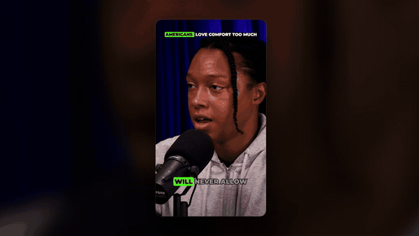
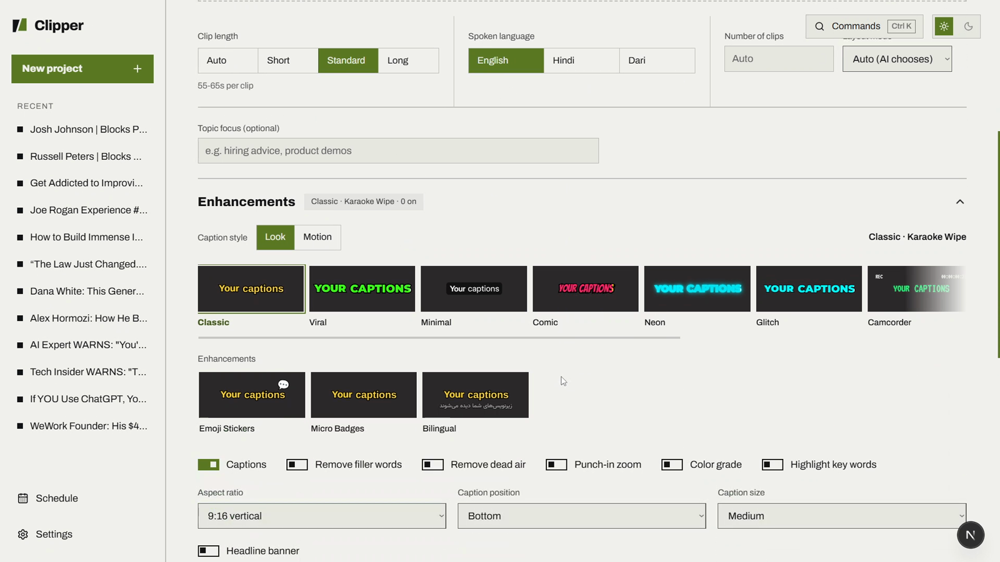
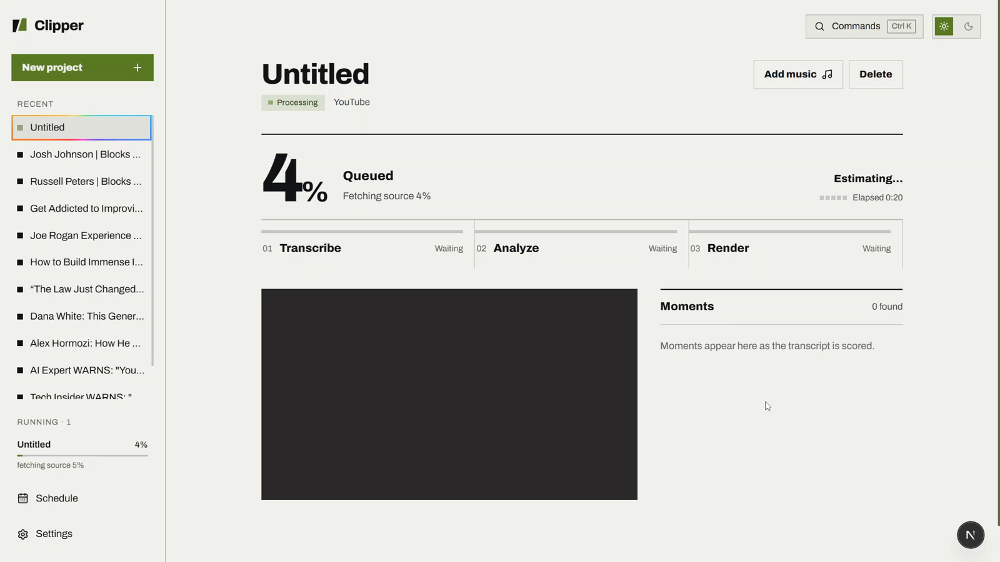
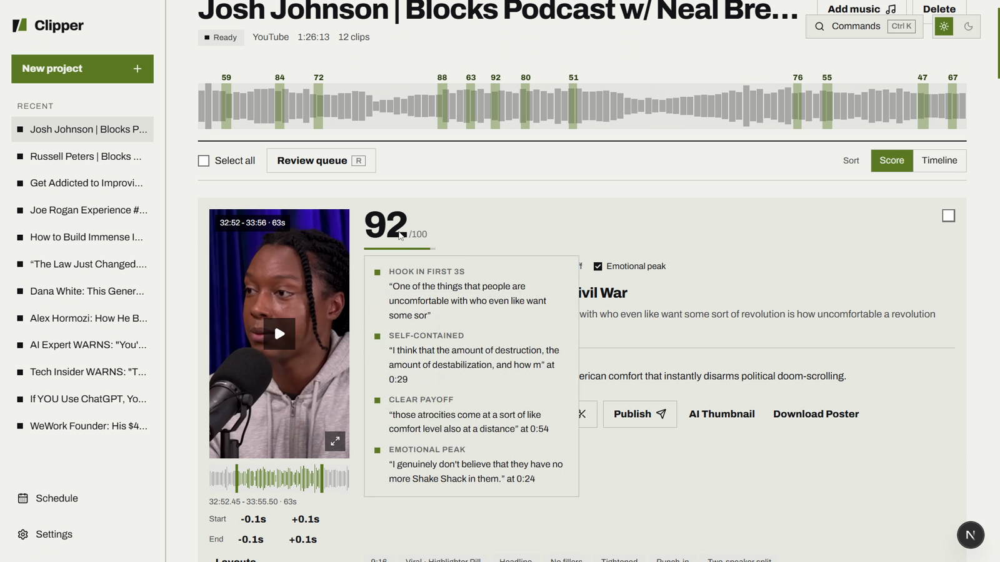
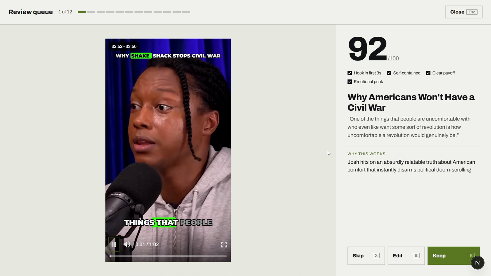
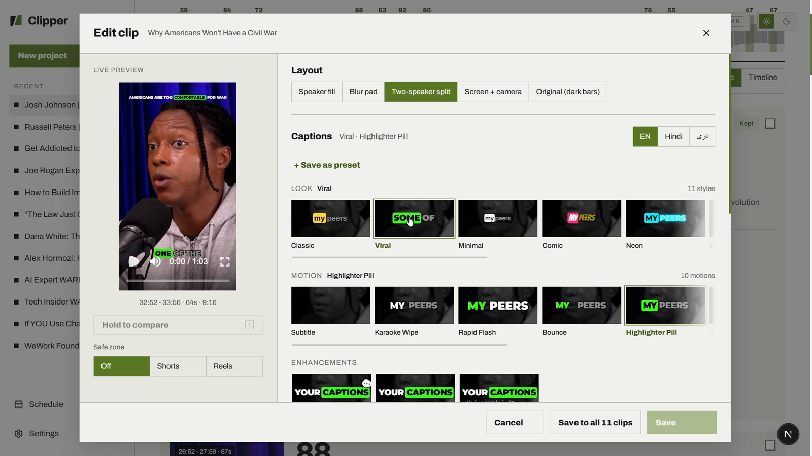
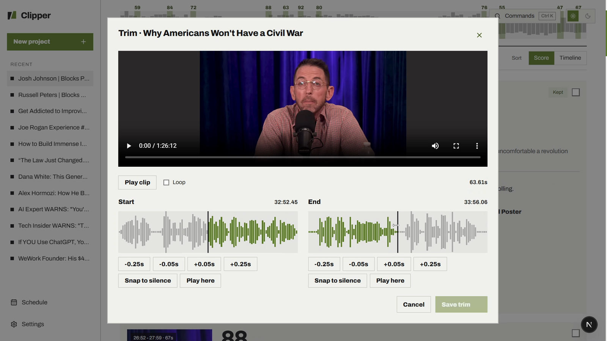
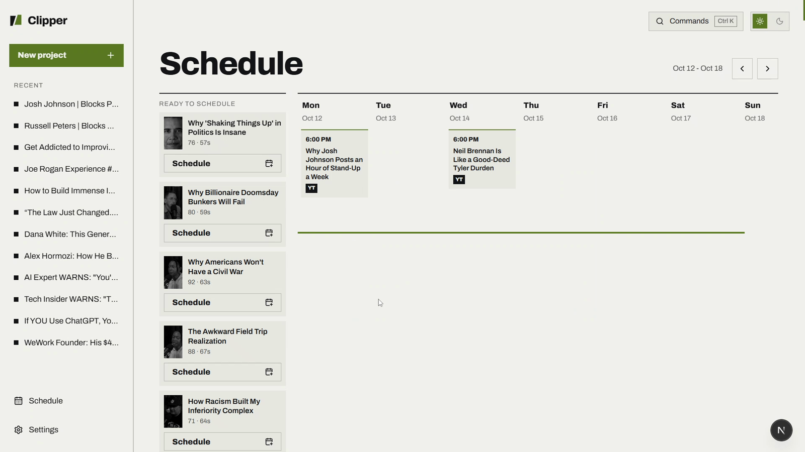

# Clipper

**Long videos in. Ready to post clips out.**

Clipper is an AI tool I built that takes a long video (a podcast, an interview, a talk), finds the moments worth posting, cuts them on clean sentence and pause boundaries, reframes them to vertical around whoever is speaking, adds animated word by word captions and publishes them to YouTube, Instagram, Facebook and TikTok on a schedule.

[Watch the 3 minute demo](media/clipper-demo.mp4)

> This is a showcase repository. Clipper's full source code is private. A code walkthrough is available on request: zaeemjalali@gmail.com

## What it does

* **Finds the moments.** Every clip gets a score out of 100, broken down into signals (hook in the first 3 seconds, self contained, clear payoff, emotional peak), each backed by a quote from the transcript.
* **Cuts cleanly.** Clip bounds snap to sentence edges, then a second pass finds a real pause in the audio and cuts inside it, so a clip never stops mid word.
* **Reframes to vertical.** MediaPipe face tracking keeps the speaker in frame for 9:16, 1:1, 4:5 or 16:9.
* **Edits instantly.** Captions are drawn as a live layer over the video in the browser, so switching styles or timing needs no render. The final captions are burned in only on export.
* **Reviews fast.** A keyboard review queue: K to keep, X to skip, then one click deletes everything skipped.
* **Publishes on a schedule.** A drag and drop week calendar posts to four platforms through their official APIs, with safe retries and automatic rescheduling around YouTube's daily upload limit.
* **Edits raw recordings too.** A second mode where an LLM "director" plans the cuts, stock footage, on screen text and music for a talking head recording, with animated graphics rendered in Remotion.

## How it works

* **Backend:** Python and FastAPI, with a separate polling job worker and SQLite. Jobs stream their progress to the browser over Server Sent Events.
* **Frontend:** Next.js, TypeScript and Tailwind CSS.
* **AI:** faster-whisper for word level transcripts, Gemini for moment finding and social copy, free OpenRouter models as an automatic fallback when Gemini is overloaded.
* **Media:** FFmpeg for cutting, reframing, captions and loudness, MediaPipe for face tracking, Remotion for animated graphics.
* **Quality:** 1,257 automated backend tests (pytest).
* **Runs locally** on a 2 core laptop, on free AI tiers.

## Screenshots

| | |
| --- | --- |
|  |  |
| New project, caption styles | Processing, with a time estimate learned from past jobs |
|  |  |
| Scored clips and the evidence behind each score | Keyboard review queue |
|  |  |
| Caption editor with live preview | Trim on the waveform, snapping to silence |
|  | |
| Publishing calendar | |

## Code samples

Three self contained pieces from the private codebase:

* [`samples/endcut.py`](samples/endcut.py): places a clip's cut inside real silence. Transcript word times drift, so it reads the audio energy and finds the first genuine pause after the last word. Tests in [`samples/tests/test_endcut.py`](samples/tests/test_endcut.py).
* [`samples/eta.py`](samples/eta.py): the processing screen's time estimate. It records how fast each step ran on this machine, then blends the median of past jobs with the job's live speed and reports a range with a confidence level.
* [`samples/llm_fallback.py`](samples/llm_fallback.py): the LLM entry point. It rotates through API keys and models, cools down a model that is overloaded, separates outages from bad answers and falls back to free OpenRouter models.

## Built by

**Zaeem Jalali**, BS Computer Science (Artificial Intelligence) student at Preston University, Islamabad. Open to roles in AI engineering and AI automation.

[GitHub](https://github.com/Zaeem-Jalali) · zaeemjalali@gmail.com

Demo footage: Blocks Podcast w/ Neal Brennan, used under CC BY.

Copyright 2026 Zaeem Jalali. All rights reserved. See [LICENSE](LICENSE).
